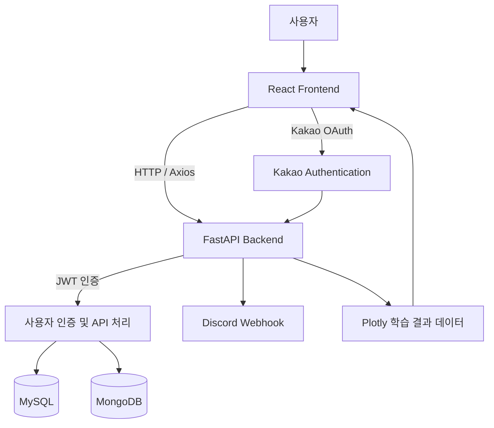
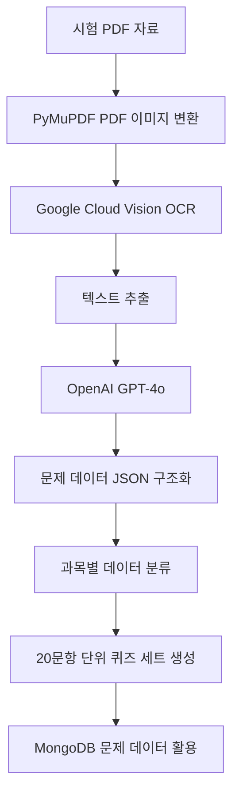

# AQUA – 생활스포츠지도사 2급 시험 대비 퀴즈 플랫폼

**AQUA**는 생활스포츠지도사 2급 필기시험을 준비하는 사용자가 과목별 문제를 풀고, 풀이 결과와 오답을 확인하며 학습 현황을 관리할 수 있도록 개발한 모바일 중심의 퀴즈 웹 애플리케이션입니다.

7개 시험 과목을 기반으로 퀴즈 풀이, 결과 저장, 오답 복습, 학습 결과 시각화 기능을 제공합니다.

## 1. 프로젝트 소개

| 항목 | 내용 |
|---|---|
| 프로젝트명 | AQUA |
| 개발 기간 | 2024.12 ~ 2025.04 |
| 프로젝트 유형 | 생활스포츠지도사 2급 시험 대비 퀴즈 웹 애플리케이션 |
| 주요 사용자 | 생활스포츠지도사 2급 시험 준비생 |
| 담당 영역 | 프론트엔드 개발, UX 및 서비스 기획 |
| 운영 경험 | 배포 후 약 1개월간 사용자 피드백 반영 |

## 2. 주요 기능

### ① 카카오 로그인 및 사용자 인증
- 카카오 OAuth 2.0 기반 로그인
- 로그인 후 JWT 발급 및 사용자 인증
- 브라우저 LocalStorage를 활용한 토큰 및 사용자 정보 관리
- 토큰 만료 시간을 고려한 클라이언트 인증 상태 관리
<p align="center">
    
    
</p>


### ② 7개 과목별 퀴즈 풀이
- 스포츠사회학, 스포츠교육학, 스포츠심리학, 한국체육사, 운동생리학, 운동역학, 스포츠윤리
- 과목별 퀴즈 세트 제공
- 한 세트당 20문항 구성
- 문제별 선택지 입력 및 이전·다음 문항 이동
- 풀이 시간 표시
- 답안 제출 및 점수 확인
<p align="center">
    
    
    
    
</p>


### ③ 오답노트 및 문제 복습
- 사용자별 퀴즈 풀이 이력 조회
- 이전에 제출한 문제 세트 선택
- 선택한 답과 정답 비교
- 문항별 해설 확인
- 과거 풀이 결과를 활용한 복습 지원
<p align="center">
    
    
    
</p>


### ④ 마이페이지 및 학습 결과 시각화
- Plotly 기반 Sunburst 차트로 학습 결과 시각화
- 과목별 평균 점수 조회
- 사용자별 누적 풀이 결과 확인
<p align="center">
    
    
</p>


### ⑤ 문제 오류 제보
- 퀴즈 화면에서 문제 오류 제보 모달 호출
- 오류 유형, 문항 번호, 상세 내용 입력
- Discord Webhook을 활용한 오류 제보 전달
- 풀이 화면을 벗어나지 않고 문제 오류 접수 가능
<p align="center">
    
</p>

## 3. 기술 스택

### Frontend
- React 19
- React Router DOM
- Axios
- Plotly.js / react-plotly.js
- React Select
- CSS Modules

### Backend
- Python
- FastAPI
- SQLAlchemy
- Pydantic
- PyJWT
- Requests

### Database
- MySQL
- MongoDB

### AI 및 데이터 처리
- OpenAI GPT-4o
- Google Cloud Vision API
- PyMuPDF
- Sentence Transformers
- FAISS
- Pandas

### Deployment & Infrastructure
- Docker
- Docker Compose
- Nginx
- Certbot
- AWS RDS 환경 설정

## 4. 시스템 아키텍처

### 서비스 구성



### 데이터 처리 파이프라인

문제 데이터 가공을 위해 별도의 Python 기반 데이터 처리 코드를 구성했습니다.



별도로 GPT 기반 텍스트 정제와 Sentence Transformers 임베딩, FAISS 인덱스 저장을 수행하는 코드도 포함되어 있습니다. 해당 코드는 별도의 데이터 처리 스크립트이며, 현재 서비스의 퀴즈 제공 API에 직접 연결된 기능으로 설명하지 않습니다.

## 5. 데이터베이스 설계

### MySQL

사용자 및 퀴즈 풀이 결과와 진행 정보를 관리합니다.

| 테이블 | 주요 역할 |
|---|---|
| users | 사용자 정보 및 카카오 계정 식별 |
| user_progress | 과목별 마지막 퀴즈 세트 진행 정보 |
| quiz_set_result | 퀴즈 세트별 제출 결과 및 점수 |
| quiz_result | 문항별 사용자 답안 및 정오답 정보 |

### MongoDB

과목별 퀴즈 데이터를 관리합니다.

- 과목 코드별 컬렉션 구성
- 퀴즈 세트 ID를 기준으로 문제 데이터 조회
- 문항 ID, 문제 내용, 보기, 정답, 해설 등의 JSON 데이터 관리

### 데이터 관리 방식

- MySQL: 사용자, 학습 진행 상태, 풀이 결과 등 관계형 데이터 관리
- MongoDB: 과목별 문제 세트와 문항 콘텐츠 관리

문제 콘텐츠와 사용자별 풀이 결과를 분리하여 각각의 데이터 특성에 맞게 관리하도록 구성했습니다.

## 6. 담당 업무 및 구현 내용

**Frontend 개발 및 UX/서비스 기획**

사용자가 실제 시험을 준비하는 과정에서 문제 풀이부터 결과 확인, 오답 복습까지 자연스럽게 이어질 수 있도록 화면 흐름과 주요 사용자 기능을 구현했습니다.

### 주요 담당 기능

**1) 과목 선택 및 퀴즈 화면**
- 7개 과목 선택 화면 구현
- API를 통한 과목별 퀴즈 데이터 조회
- 문항별 답안 선택 및 상태 관리
- 이전·다음 문항 이동
- 풀이 시간 표시 및 답안 제출
- 제출 결과를 백엔드 API에 전달

**2) 오답노트 화면**
- 사용자별 풀이 이력 목록 구현
- 선택한 풀이 결과에 따른 문항 데이터 조회
- 사용자 답안, 정답, 해설 표시
- 과거 학습 결과를 다시 확인할 수 있는 화면 구성

**3) 마이페이지 및 데이터 시각화**
- Axios를 활용한 학습 결과 API 연동
- Plotly Sunburst 차트 적용
- 과목별 평균 점수 표시
- 서버에서 전달받은 학습 데이터를 화면에 맞게 가공

**4) 문제 오류 제보 UX**
- 문제 풀이 화면에서 오류 제보 모달을 호출하도록 구현
- 오류 유형, 문항 번호, 상세 설명 입력 기능 구현
- 제보 완료 후 입력 상태 초기화
- 페이지 이동 없이 오류를 접수할 수 있도록 사용자 흐름 개선

## 7. 개발 과정에서의 문제 해결

### 서버와 클라이언트 간 데이터 구조 불일치 해결

마이페이지 학습 결과를 연동하는 과정에서 서버 응답 JSON 구조와 클라이언트에서 기대하는 데이터 구조가 일치하지 않는 문제가 있었습니다.

이를 해결하기 위해 API 응답 구조와 프론트엔드 데이터 접근 방식을 확인하고, 데이터 매핑 기준을 맞춰 화면에 학습 결과가 정상적으로 표시되도록 수정했습니다.

**해결 과정**
1. 서버 응답 데이터 구조 확인
2. 클라이언트에서 사용하는 데이터 필드와 비교
3. API 데이터 매핑 방식 수정
4. 과목별 평균 점수 및 학습 결과 차트 연동 확인

이 경험을 통해 화면 구현뿐 아니라 API 명세와 데이터 구조를 함께 이해하는 것이 프론트엔드 개발에서 중요하다는 점을 배웠습니다.

## 8. 프로젝트를 통해 얻은 경험

- React 기반 컴포넌트 및 상태 관리 경험
- Axios를 활용한 REST API 연동 경험
- JWT 기반 인증 흐름 및 클라이언트 인증 상태 관리 경험
- Plotly를 활용한 데이터 시각화 구현 경험
- MySQL과 MongoDB를 활용한 데이터 관리 구조 이해
- 실제 사용자 피드백을 반영한 UX 개선 경험
- 프론트엔드와 백엔드 간 API 데이터 구조 협업 경험
- OCR 및 LLM 기반 문제 데이터 가공 파이프라인 이해

## 9. 실행 환경

### Frontend

```bash
cd frontend
npm install
npm start
```

개발 서버는 기본적으로 `http://localhost:3000`에서 실행됩니다.

프론트엔드 환경 변수:

```env
REACT_APP_BACKEND_URL=
```

### Backend

백엔드 실행에 필요한 환경 변수를 설정한 후 실행합니다.

```bash
cd backend
docker compose up --build -d
```

주요 환경 변수 항목:

```env
DATABASE_PY_URL=
RDS_HOST=
RDS_PORT=
RDS_DB_NAME=
MYSQL_PW=
MONGO_PW=

KAKAO_CLIENT_ID=
KAKAO_REDIRECT_URI=
LOGIN_REDIRECT_URI=

SECRET_KEY=
ALGORITHM=

DISCORD_WEBHOOK_URL=
OPENAI_API_KEY=
```

Google Cloud Vision API 사용 시 서비스 계정 인증 정보도 별도로 설정해야 합니다.

> 실제 배포 및 실행을 위해서는 각 서비스의 인증 정보와 환경에 맞는 설정이 필요합니다. API 키, 비밀번호, 서비스 계정 키 등 민감 정보는 저장소에 업로드하지 않아야 합니다.

---

**AQUA는 시험 준비 과정에서 발생하는 문제 풀이, 결과 확인, 오답 복습을 하나의 서비스 흐름으로 연결하는 데 초점을 둔 프로젝트입니다.** 실제 사용자 피드백을 반영하며 기능을 개선하고, 프론트엔드와 백엔드 간 데이터 연동을 경험했습니다.
